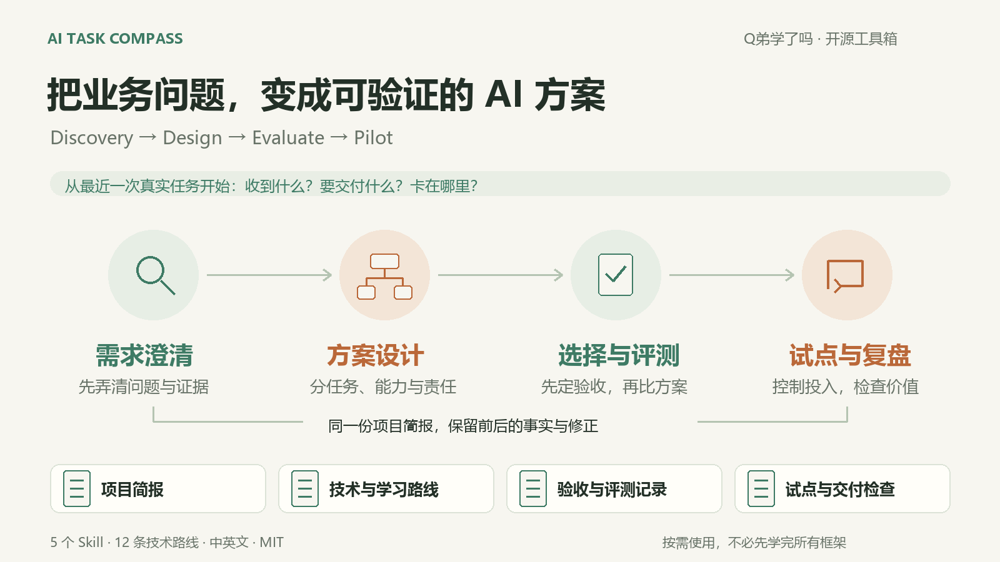
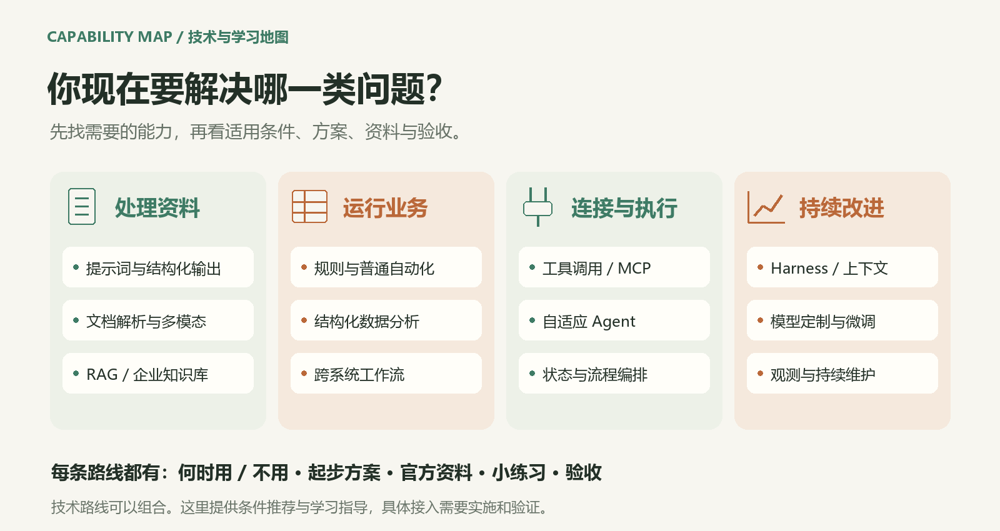
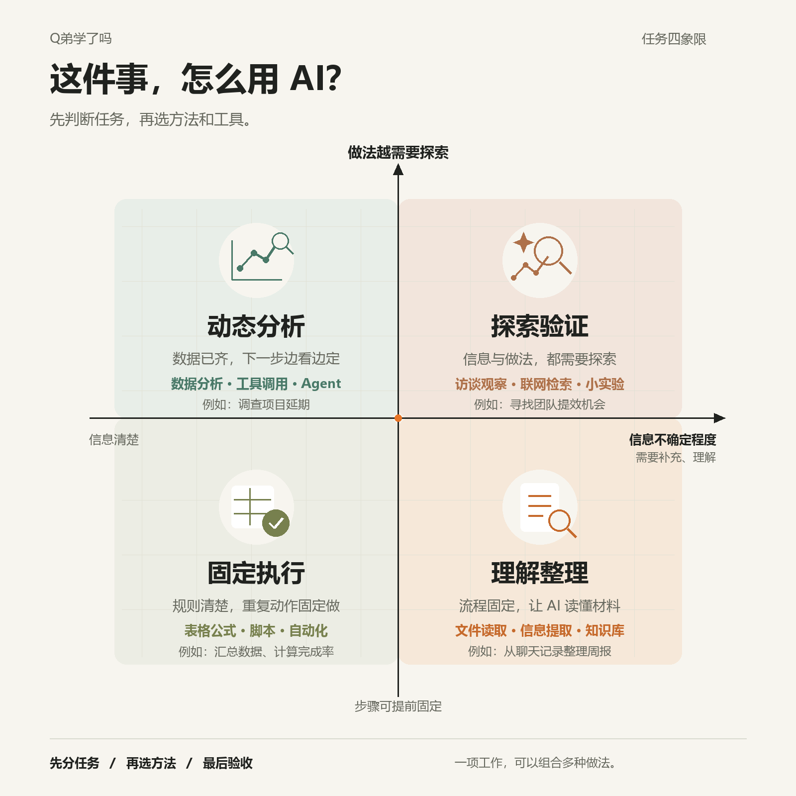

# AI Task Compass · AI 业务规划工具箱

**把业务问题，变成可以验证的 AI 方案。**  
Turn a business problem into a testable AI plan.

**[开始使用 · 中文](https://codyqin.github.io/ai-task-compass/)** · **[Start · English](https://codyqin.github.io/ai-task-compass/en.html)** · **[全部入口 / Start here](START-HERE.md)** · **[下载 / Download](https://github.com/CodyQin/ai-task-compass/releases/latest)**

<p align="center"><a href="assets/toolkit-overview.png"></a></p>

面向有具体流程要改善的老板、产品经理、创业者与自媒体。一个统一入口、四个独立模块，按需要选择步骤；普通聊天复制提示词即可开始。  
For owners, PMs, founders and creators improving real workflows. One entry point and four independent modules; use the full prompt in your AI chat.

## 一行安装，一句话开始 · Install once, then ask

已在用 Codex / Claude Code？在终端安装统一入口（需要 Node.js 22.20+、Git 和可用的 AI 工具）：  
Already using a skill-capable tool? Install the integrated entry from your terminal:

```sh
npx skills add CodyQin/ai-task-compass --skill task-compass -g
```

按提示选工具。之后在 **AI 对话里**输入，再直接说你想做什么：  
Select your tool, then invoke it **inside your AI conversation** and describe your work:

| 工具 / Tool | 启动示例 / Start |
|---|---|
| Codex | `$task-compass 帮我梳理这个业务，判断哪里值得用 AI。` |
| Claude Code | `/task-compass 帮我梳理这个业务，判断哪里值得用 AI。` |

[安装、更新与排错 · 中文](docs/install-and-start.zh-CN.md) · [English setup](docs/install-and-start.en.md)  
不想安装？继续使用[网页入口](https://codyqin.github.io/ai-task-compass/)复制完整消息到常用 AI。 / Prefer no setup? Use the [web starter](https://codyqin.github.io/ai-task-compass/en.html).

## 你想先做什么？ · Pick an entry

| 现在的目标 / Your goal | 直接进入 / Open |
|---|---|
| 描述问题，让 AI 帮我梳理 / Start with a real problem | [中文入口](https://codyqin.github.io/ai-task-compass/) · [English](https://codyqin.github.io/ai-task-compass/en.html) |
| 找到适合业务的技术路线 / Choose a technical route | [可交互路线导航 / Navigator](https://codyqin.github.io/ai-task-compass/solution-navigator.html) |
| 学会怎样推进 / Learn how to proceed | [业务手册](docs/business-playbook.zh-CN.md) · [Business playbook](docs/business-playbook.en.md) |
| 了解或独立加载 Skill / Use the Skills | [合集说明](docs/skill-collection.zh-CN.md) · [English](docs/skill-collection.en.md) · [五个 Skill](skills/) |
| 复制模板，开始自己的项目 / Start your project brief | [项目简报 / Project brief](templates/PROJECT-BRIEF.md) · [试点工作表 / Worksheet](WORKSHEET.md) |
| 对照模型、质量和成本 / Compare quality and cost | [模型选择](docs/model-selection.zh-CN.md) · [业务测算 / Calculator](https://codyqin.github.io/ai-task-compass/business-calculator.html) |
| 集中浏览全部资料 / Browse all resources | **[项目总导航 / Full navigation](START-HERE.md)** |

## 从业务需要找技术 · Find the capability you need

<p align="center"><a href="https://codyqin.github.io/ai-task-compass/solution-navigator.html"></a></p>

[技术地图 · 中文](docs/technical-routes.zh-CN.md) · [English routes](docs/technical-routes.en.md) · [按角色学习](docs/learning-paths.zh-CN.md) · [Learning paths](docs/learning-paths.en.md)

每条路线说明适用/不适用、起步方案、前提、官方资料、练习与验收。技术可以组合，不要求全部学习或安装。  
Each route covers use/avoid conditions, a simple start, prerequisites, official resources, an exercise and acceptance. Combine only what is needed.

## 快速开始 · Quick start

<details>
<summary><strong>English — expand the quick start</strong></summary>

1. Open the [English starter](https://codyqin.github.io/ai-task-compass/en.html), describe one real task and generate a starter message.
2. Copy it into your AI chat. Answer the next useful question; unknowns are allowed.
3. Review the brief and choose one bounded next step. No installation or API key is required by this project; your AI provider may charge.

Prefer plain text? Copy [PROMPT.en.md](PROMPT.en.md). Skill users can load the relevant folder from [skills/](skills/). See the [detailed guide](README.en.md) or [full navigation](START-HERE.md) for everything else.

</details>

<details open>
<summary><strong>简体中文 — 默认展开 / 点击收起</strong></summary>

1. 打开[中文使用页](https://codyqin.github.io/ai-task-compass/)，描述一项真实工作，生成开始消息。
2. 复制到常用 AI，回答最影响判断的问题；不知道的地方可以保留未知。
3. 核对项目简报，选一个小范围的下一步，再验证是否值得继续。

也可直接复制 [PROMPT.md](PROMPT.md)。使用 Skills 的工具可加载 [skills/](skills/) 中需要的模块。普通使用不需要安装或提供 API Key，所选 AI 服务可能收费。

[完整中文说明](README.zh-CN.md) · [项目总导航](START-HERE.md)

</details>

<details>
<summary><strong>辅助图：任务四象限 / Task-quadrant reference</strong></summary>

这是方案设计阶段的一个判断工具，按具体任务环节使用；不代表价值或成熟度排名。

<p align="center"><a href="assets/task-quadrants.png"></a></p>

[为什么选这两个维度](docs/methodology.zh-CN.md) · [English methodology](docs/methodology.en.md) · [PNG](assets/task-quadrants.png) · [SVG](assets/task-quadrants.svg)

</details>

## 范围与维护 · Scope and maintenance

当前交付：规划 Skills、提示词、路线与资料、模板、消息生成页和本地业务测算器。技术建议与蓝图不等于已接通业务系统。  
Available: planning skills, prompts, routes/resources, templates, message preparation and local calculations. Blueprints are not deployed integrations.

页面不向本项目发送任务内容；粘贴到 AI 后适用所选服务的数据政策。使用脱敏资料。[覆盖与交付层级](docs/coverage-and-scope.md) · [贡献与维护](docs/maintenance.md)

Maintained by [Cody Qin](https://github.com/CodyQin) / Q弟学了吗 · [MIT](LICENSE). External services retain their own terms and licenses.
