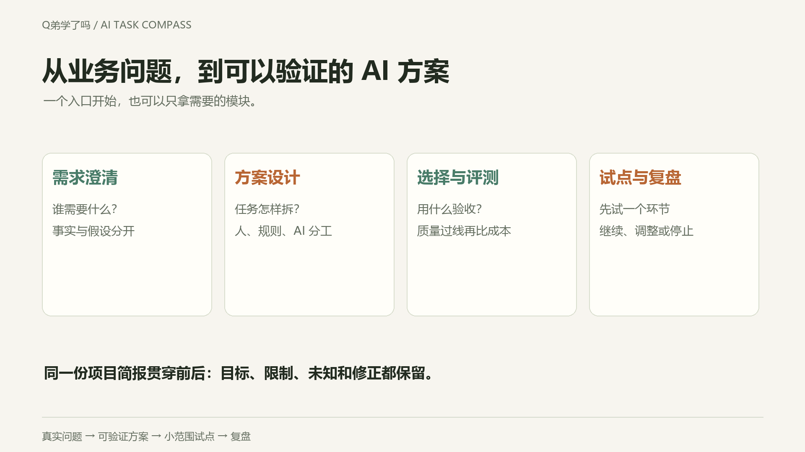

# AI Task Compass · AI 任务指南针

**想用 AI 改善业务，却不知道从哪里开始、怎么选、怎样验收？**  
How do you turn a business problem into a testable AI plan?

从真实任务出发，通过简短访谈，得到任务拆分、四象限判断、工具路线和可验收的小试点。  
Describe real work. Get useful questions, a task map, tool routes and a small pilot.

**[立即使用 · 中文](https://codyqin.github.io/ai-task-compass/)** · **[Try it · English](https://codyqin.github.io/ai-task-compass/en.html)** · **[下载 / Download](https://github.com/CodyQin/ai-task-compass/releases/latest)**

无需安装 · 无需向本项目提供 API Key · 中英文 · [MIT](LICENSE)  
No installation or API key required by this project. Bring your own AI chat.

## 项目流程 · The planning flow

## 项目全貌 · The complete toolkit

从业务问题到可验证方案：**澄清需求 → 设计流程 → 选择与评测 → 小范围试点 → 复盘**。步骤可跳过，四象限只服务方案设计。

**[五个 Skill 怎么用 / Skill collection](docs/skill-collection.zh-CN.md)** · **[English guide](docs/skill-collection.en.md)** · **[项目简报 / Shared brief](templates/PROJECT-BRIEF.md)** · **[为什么这样设计](docs/design-rationale.zh-CN.md)** · **[Design rationale](docs/design-rationale.en.md)**

适合有具体流程要改善的老板、产品经理、创业者与自媒体；不要求先懂技术。现有聊天复制完整提示词即可，支持 Skills 的工具可独立安装模块。

A planning toolkit for owners, PMs, founders and creators improving specific workflows. Use the full prompt in chat or load modules in a skill-capable tool. It supplies analysis and templates, not automatic business-data access or deployed systems.

<strong>展开任务四象限 · Task map used during solution design</strong>

## 一图理解 · The task map

  

**[保存高清 PNG](assets/task-quadrants.png)** · **[下载矢量 SVG](assets/task-quadrants.svg)**  
Read the Chinese diagram above; English definitions are in the English guide below. Classify task steps, not whole businesses. A quadrant is not a value ranking.

## 直接拿来用 · Your toolkit

| 你现在想做什么 / Your goal | 入口 / Resource |
|---|---|
| 不安装，马上开始 / Start without setup | [中文网页](https://codyqin.github.io/ai-task-compass/) · [English page](https://codyqin.github.io/ai-task-compass/en.html) |
| 把完整提示词交给 AI / Copy the full protocol | [中文提示词](PROMPT.md) · [English prompt](PROMPT.en.md) |
| 在支持技能的 Agent 中使用 / Load an Agent Skill | [task-compass Skill](skills/task-compass/) |
| 对照实际场景理解 / Learn from worked examples | [中文场景](examples.md) · [English examples](examples.en.md) |
| 看工具候选和使用前提 / Compare tool routes | [中文路线](skills/task-compass/references/tool-routes.md) · [English routes](skills/task-compass/references/tool-routes.en.md) |
| 把建议变成自己的试点 / Plan your own pilot | [中英文任务工作表 / Bilingual worksheet](WORKSHEET.md) |
| 离线保存整套资料 / Keep the full kit offline | [最新下载包 / Latest release](https://github.com/CodyQin/ai-task-compass/releases/latest) |

中英文完整说明均在本页，点击语言标题展开或收起。中文默认展开。  
Both full guides stay on this page. Expand a language below; Chinese is open by default.

## 从判断到业务方案 · From task map to business plan

| 继续解决的问题 / Next question | 中文 | English |
|---|---|---|
| 为什么选这两个维度？ / Why these axes? | [理论与边界](docs/methodology.zh-CN.md) | [Methodology](docs/methodology.en.md) |
| 老板和 PM 怎么推进？ / Owner and PM decisions | [业务手册](docs/business-playbook.zh-CN.md) | [Business playbook](docs/business-playbook.en.md) |
| 哪种模型适合自己的任务？ / Which model fits? | [选择与评测](docs/model-selection.zh-CN.md) | [Model selection](docs/model-selection.en.md) |
| 工具怎样组合成方案？ / How to assemble a route | [四条设计蓝图](docs/solution-blueprints.zh-CN.md) | [Four blueprints](docs/solution-blueprints.en.md) |
| 怎样量化时间与钱？ / How to estimate time and money | [离线测算器 / Calculator](https://codyqin.github.io/ai-task-compass/business-calculator.html) | [评测记录 / Evaluation CSV](templates/model-evaluation.csv) |

蓝图为设计示例，不是已部署模板；测算是假设下的结果，不是收益承诺。  
Blueprints are illustrative designs, not deployed templates. Calculations are conditional estimates, not promised returns.

<strong>English — click to expand / 点击展开英文</strong>

**Should this task use AI, a workflow, an agent—or just a better process?**

A practical, open-source conversation framework that helps you describe real work, answer a few useful questions, and turn it into a task breakdown, tool route and small pilot. Designed for people who understand their work but may not know which AI architecture to choose.

No account, API key or installation is required by this project. Bring your own AI chat; that provider may charge for usage.

## Start in a minute

1. Open the **[English page](https://codyqin.github.io/ai-task-compass/en.html)** or **[中文页面](https://codyqin.github.io/ai-task-compass/)**.
2. Describe one actual task, generate a starter message, then copy it into your AI assistant.
3. Answer its clarifying questions and ask for one small next step.

**Prefer copy and paste?** Open [PROMPT.en.md](PROMPT.en.md) or [PROMPT.md 中文](PROMPT.md), click **Raw**, copy the full text into a new chat, then add your task. No web page is needed.

Try this:

> Each week I turn dozens of customer comments into a report. I manually label, count and summarize them. I want fewer missed issues, but don't know whether to use chat or a workflow. Ask the most important clarifying question first. Reply in English.

## What you get

| Deliverable | What it helps you decide |
|---|---|
| A confirmed problem statement | What matters, what is known and what still needs evidence |
| A step-by-step task map | Which parts need rules, interpretation, analysis or exploration |
| Human / AI / tool responsibilities | Where review or process changes are needed |
| Up to two tool routes | Start with available tools; understand upgrade conditions |
| A small pilot | Samples, acceptance measures, owner, intervention and stop conditions |
| Cost and benefit questions | Include preparation, maintenance, checking and rework |

Start with one step and a few authorized samples. Check the proposed understanding before implementing a plan. This is decision support, not an autonomous execution service.

## The four-quadrant lens

| | Known, stable information | Varied or uncertain information |
|---|---|---|
| **Adaptive path** | **Q3 · Adaptive analysis** — choose the next step from intermediate evidence | **Q4 · Explore & validate** — clarify, investigate, experiment |
| **Predefined path** | **Q1 · Fixed execution** — rules, formulas, conventional automation | **Q2 · Interpret & organize** — extraction, understanding, retrieval in a defined process |

Use it on **task steps**, not an entire company. Mixed and unknown classifications are valid. These labels are not mathematical quadrant numbering or a maturity ranking. The axes are information uncertainty (rightward) and path adaptability (upward). A quadrant alone cannot establish ROI or justify an agent.

The lens is a practical heuristic, not a claimed original scientific taxonomy. The contribution here is the interview protocol and its bridge to responsibilities, implementation routes and pilot design. Tool guidance links to official documentation and distinguishes fixed workflows from adaptive agent behavior; see [route references](skills/task-compass/references/tool-routes.en.md).

## Use as an Agent Skill

Copy the complete [`skills/task-compass/`](skills/task-compass/) folder into the skills directory supported by your agent, and follow that agent's loading instructions. Then ask:

> Use task-compass to help me decide how to improve this task. Reply in English.

Directory conventions vary; this is not a universal installer. If your tool does not support skills, use the standalone prompt instead. The skill includes Chinese and English guidance and should respond in your requested language.

## Plan your first pilot

Use the **[bilingual task & pilot worksheet](WORKSHEET.md)** to keep facts, assumptions, responsibilities, acceptance measures and costs in one place. Fill only what you know; let the interview identify the next useful gap.

## Examples

See **[worked examples](examples.en.md)** / **[中文场景](examples.md)**: reports, feedback, knowledge bases, adaptive analysis, unclear goals and career work. Examples are synthetic illustrations, not measured model runs or customer case studies.

## Privacy and scope

The starter pages assemble text in your browser. They make no model calls, add no analytics and send no task content to this project. GitHub hosting has its own access logs. Once you paste a message into an AI product, that provider's data policy applies. Use anonymized material, never secrets or unnecessary customer data.

The framework does not install software, deploy systems, contact clients, modify business records or spend API credits. Those require a separately authorized implementation scope.

## FAQ

**Is it free?** The repository is MIT-licensed. AI providers and external platforms have separate terms, availability and costs.

**Does the website answer my question?** It prepares a complete message. Your chosen AI conducts the conversation after you paste it.

**Will it always ask many questions?** It should ask the next decision-relevant question, reuse context and allow unknowns. You can request a provisional plan with explicit assumptions.

**Is the output proven?** v0.3 ships usable prompts, a skill and standalone pages. No controlled model benchmark or measured business gains are claimed. Review recommendations against your real work.

**What if a recommended tool is unavailable?** Tell the assistant your region, budget, existing accounts and deployment limits. Ask for accessible alternatives and recheck official terms before adoption.

## Download, maintain and contribute

- Download a **[release ZIP](https://github.com/CodyQin/ai-task-compass/releases/latest)** or use GitHub **Code → Download ZIP**. Open `index.html` or `en.html` locally; internet is only needed for your AI product and external links.
- Only Python **3.10+**, standard library, is needed to rebuild; end users need no Python.
- After editing the skill or references, run `python scripts/build_prompt.py`. Run `python scripts/build_prompt.py --check` before a PR. CI checks generated files on pushes and PRs.
- Keep Chinese and English aligned. New examples should state inputs, expected reasoning and limitations. Report problems through [Issues](https://github.com/CodyQin/ai-task-compass/issues), with an anonymized task, model/date, observed problem and expected behavior. Do not post private business data.

Maintained by **[Cody Qin](https://github.com/CodyQin) / Q弟学了吗**. Contributions are welcome; response times and business outcomes are not guaranteed.

## License

[MIT](LICENSE) for this project's original material. Referenced tools and third-party content retain their own licenses and conditions. This license does not relicense them.

<strong>简体中文 — 默认展开 / 点击展开或收起</strong>

**从“我想用 AI”走到“这一步先这样做”。**

适合有真实工作要改善、却不确定该直接问 AI、做知识库、搭工作流还是开发 Agent 的人。懂业务但不懂技术，也可以从一句日常描述开始。

## 30 秒开始

1. **[打开中文入口](https://codyqin.github.io/ai-task-compass/)**，写下最近一次想改善的工作。
2. 点击“生成开始消息”，复制到你常用的 AI 对话。
3. 回答最关键的问题，核对任务拆分，再选择一个环节试用。

不想用网页？打开 **[完整中文提示词](PROMPT.md)**，点击 **Raw**，复制全文到 AI，再补上你的任务。英文请用 [PROMPT.en.md](PROMPT.en.md)。普通聊天使用不需要安装 Skill。

你可以直接这样描述：

> 我每周要整理几十条客户反馈，目前手动打标签、统计、写总结。我想减少漏项，不知道应该直接用 AI 还是做工作流。请先问我一个最影响判断的问题，用中文回答。

本项目无需注册、无需提供 API Key；你使用的 AI 产品可能收费。网页只生成完整消息，实际访谈在所选 AI 中进行。

## 最后能拿到什么

| 你关心的问题 | 框架引导 AI 交付的内容 |
|---|---|
| 这件事究竟要解决什么？ | 目标、输入、输出和限制；事实与假设分开 |
| 什么时候用 AI？ | 按具体环节判断象限，允许混合或暂不可判定 |
| AI 应该负责多少？ | 人、规则、模型、检索和工具各自的职责 |
| 先用哪个工具？ | 简单起步路线；需要时再给工程化升级路线 |
| 怎样知道有没有用？ | 小范围试点、质量标准、人工检查和停止条件 |
| 到底值不值得做？ | 准备、调用、维护、检查、返工成本，以及待测收益 |

## 四象限怎么读

横轴向右：信息越不确定，越需要补充或理解。纵轴向上：做法越需要根据中间结果调整。

| | 信息清楚、稳定 | 信息多变、需要理解或补充 |
|---|---|---|
| **路径动态调整** | **Q3 动态分析**：按结果继续计算、查询、核实 | **Q4 探索验证**：澄清、调查、收集证据、小实验 |
| **步骤可提前固定** | **Q1 固定执行**：现成系统、公式、脚本、普通自动化 | **Q2 理解整理**：在固定流程里加入理解、提取、检索 |

分类对象是**任务环节**，整项工作可以跨象限。同一环节也会随资料与流程完善而迁移。编号是项目标签，不是数学坐标系的标准象限编号；位置不代表高级程度、风险或 ROI。

## 一个任务如何变成方案

**合成教学示例，非客户项目或模型实测：整理每周反馈报告。**

| 环节 | 暂定判断 | 起步做法 | 怎么检查 |
|---|---|---|---|
| 读反馈、提取问题和原文证据 | 标签与流程确定时，主要是 Q2 | 先用已有文件读取助手，按固定字段输出 | 漏项、误标、没有原文支持的结论 |
| 统计已确认的标签 | 规则确定时，主要是 Q1 | 电子表格或小脚本 | 重复项、缺失值、总数是否一致 |
| 追查某类问题为何突然增加 | 资料较清楚、下一步随发现调整时，可能是 Q3 | 人带着工具分步查证 | 区分相关性、假设与因果证据 |

如果连报告要给谁看、标签怎么定义都没确定，就先澄清，不急着给整项工作贴标签。先拿少量脱敏样本，由人核对质量和总耗时；重复运行值得做时，再考虑工作流。

更多场景见 **[案例与判断边界](examples.md)**。开始自己的项目时，可直接复制 **[任务与试点工作表](WORKSHEET.md)**。

## 工具怎么选

| 需求 | 先尝试 | 升级前要问什么 |
|---|---|---|
| 已知规则、重复计算 | 现有表格功能或脚本 | 异常怎么处理？结果怎么核对？ |
| 多系统触发、流转、通知 | 现有系统自动化；必要时比较工作流工具 | 接口、权限、失败恢复与维护人是否明确？ |
| 阅读、提取、归类资料 | 兼容文件格式的助手，加固定输出字段 | 解析、漏项、来源证据是否合格？ |
| 反复查大量资料 | 小范围检索试点，再评估知识库 | 有效版本、访问权限、答案引用怎么管理？ |
| 根据结果连续选择工具 | 先观察一次分步分析，需要时再比较 Agent 编排 | 状态、人工接管、重试与评估怎么做？ |

具体候选、前提和官方资料见 **[工具路线地图](skills/task-compass/references/tool-routes.md)**。工具不是象限的固定答案；选型前核对当前许可、费用、地区可用性与数据处理条件。

## 作为 Skill 使用

下载仓库，把 **[skills/task-compass/](skills/task-compass/)** 整个文件夹放进你使用的 Agent 支持的技能目录，按该工具说明加载，然后说：

> 使用 task-compass 帮我分析这件工作，用中文回答。先问最影响判断的一个问题。

不同工具的安装位置不同。普通聊天产品直接使用 PROMPT.md 即可，不需要安装，也不要求会写代码。本框架只做分析和规划，不会自行部署系统、发送客户消息、写入业务数据或产生 API 支出。

## 做试点时，先确认这五件事

1. **样本：**资料已获授权并脱敏，包含典型情况和容易出错的情况。
2. **质量：**什么算可接受，谁负责核对？先提出指标，再由使用者确认阈值。
3. **时间：**记录原做法与新做法的总耗时，包括准备、检查和返工。
4. **接管：**哪些输出必须人工确认，遇到什么情况停止自动处理？
5. **价值：**节省的时间能否被重新利用？释放工时、现金节省和新增收益分开记录。

ROI 不能从象限直接推出。没有数据就保留未知，不编造提效比例，不把同一收益重复计算。具体记录见 [工作表](WORKSHEET.md)。

## 常见问题

**免费吗？** 本项目以 MIT 许可分享；模型与第三方平台可能收费，遵循各自条款。

**页面会上传我的任务吗？** 页面在浏览器里组合文字，不向本项目发送或保存任务内容，没有额外分析脚本。GitHub 托管有常规访问记录；粘贴到 AI 后，适用该服务的数据政策。不要提供密钥或不必要的客户资料。

**没有技术背景怎么办？** 用日常语言描述最近一次工作。可以回答“不知道”，也可以要求基于明确假设先给一个暂定方案。

**推荐工具在国内无法访问怎么办？** 说明地区、现有账号、预算、部署和维护条件，请 AI 给可访问候选；不要照单购买。

**效果是否经过验证？** 提示词、Skill 与页面可直接使用；结构检查通过不代表模型建议一定正确。项目没有受控模型评测或真实商业收益数据，示例均有明确标注。

## 维护、反馈与许可

修改 Skill 或工具参考后，运行 `python scripts/build_prompt.py`，再运行 `python scripts/build_prompt.py --check`。只需 Python 3.10+ 标准库；普通使用者无需 Python。欢迎 PR，中英文意图应保持一致。

通过 **[Issues](https://github.com/CodyQin/ai-task-compass/issues)** 反馈：脱敏任务、所用模型与日期、哪里判断不合适、你期待怎样改。不要上传客户原始资料或密钥。

由 **[Cody Qin](https://github.com/CodyQin) / Q弟学了吗** 维护。本项目的原创材料采用 **[MIT](LICENSE)**；外部工具、文档和服务遵循各自许可。本框架是启发式辅助，不宣称首次提出这类分类，也不承诺商业结果。

